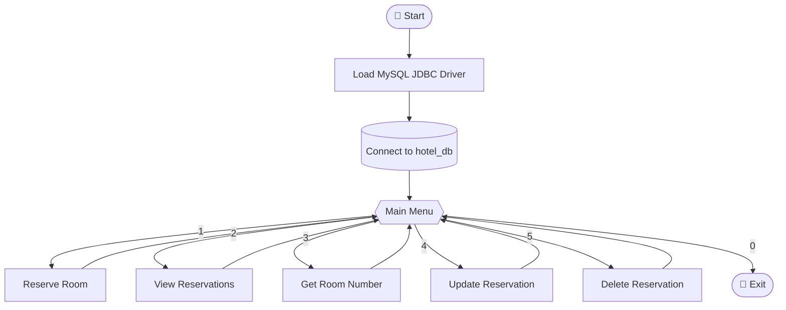

<div align="center">


<a href="https://git.io/typing-svg">
  
</a>

<br/>


<br/>


</div>

---

## ✨ About

**Hotel Reservation Management System** is a console-based Java application that connects to a MySQL database through JDBC. It lets hotel staff create, view, search, update and delete room reservations from a simple interactive menu.

It's a great project for learning **CRUD operations**, **JDBC connectivity** and **database-driven Java applications**.

---

## 🚀 Features

| | Feature | Description |
|---|---|---|
| 🛏️ | **Reserve a Room** | Book a room with guest name, room number and contact number |
| 📋 | **View Reservations** | Display all current reservations with their date and time |
| 🔍 | **Get Room Number** | Look up a room using a reservation ID + guest name |
| ✏️ | **Update Reservation** | Change guest name, room number or contact details |
| 🗑️ | **Delete Reservation** | Cancel a reservation by ID |
| 👋 | **Graceful Exit** | Animated exit message with a clean shutdown |

---

## 🧭 Application Flow



---

## 🖥️ Preview

```text
Welcome to Hotel Reservation Management System
Reserve A Room: 1
View Reservations: 2
Get Room Number: 3
Update Reservations: 4
Delete Reservations: 5
Exit: 0
Choose an option: 1

Enter Guest Name:  Aarav
Enter Room Number:  204
Enter Contact Number:  9876543210
Reservation Successful !
```

---

## 🗄️ Database Setup

Run this in MySQL to create the database and table:

```sql
CREATE DATABASE hotel_db;
USE hotel_db;

CREATE TABLE reservations (
    reservation_id   INT AUTO_INCREMENT PRIMARY KEY,
    guest_name       VARCHAR(255) NOT NULL,
    room_number      INT NOT NULL,
    contact_number   VARCHAR(20) NOT NULL,
    reservation_date TIMESTAMP DEFAULT CURRENT_TIMESTAMP
);
```

---

## ⚙️ Getting Started

### Prerequisites

- ☕ **JDK 17** or newer
- 🐬 **MySQL Server 8+**
- 📦 **MySQL Connector/J** (`mysql-connector-j` JAR)
- 🧰 Any IDE (IntelliJ IDEA, Eclipse, VS Code) or the terminal

### Installation

```bash
# 1. Clone the repository
git clone https://github.com/YOUR_USERNAME/HotelReservation.git

# 2. Move into the project
cd HotelReservation
```

### Configure the database connection

Open `HotelReservation.java` and update these values:

```java
private static final String url      = "jdbc:mysql://localhost:3306/hotel_db";
private static final String username = "root";
private static final String password = "YOUR_PASSWORD";
```

### Run it

**Using an IDE:** add the MySQL Connector/J JAR to your project libraries and run `HotelReservation`.

**Using the terminal:**

```bash
# Compile
javac -cp ".:mysql-connector-j-8.x.x.jar" HotelReservation.java

# Run (Linux / macOS)
java -cp ".:mysql-connector-j-8.x.x.jar" HotelReservation

# Run (Windows)
java -cp ".;mysql-connector-j-8.x.x.jar" HotelReservation
```

---

## 📁 Project Structure

```text
HotelReservation/
├── 📄 HotelReservation.java   # Main application (menu + CRUD logic)
├── 📄 README.md               # You are here
└── 📦 lib/
    └── mysql-connector-j.jar  # JDBC driver
```

---

## 🛣️ Roadmap

- [ ] Switch to `PreparedStatement` to prevent SQL injection
- [ ] Move DB credentials to environment variables / a config file
- [ ] Prevent double-booking of the same room
- [ ] Add check-in / check-out dates
- [ ] Add input validation and error handling for bad input
- [ ] Add a GUI using JavaFX or Swing
- [ ] Add unit tests with JUnit

---

## 🤝 Contributing

Contributions, issues and feature requests are welcome!

1. 🍴 Fork the project
2. 🌿 Create your branch: `git checkout -b feature/AmazingFeature`
3. 💾 Commit your changes: `git commit -m "Add AmazingFeature"`
4. 📤 Push to the branch: `git push origin feature/AmazingFeature`
5. 🔃 Open a Pull Request

---

## 📜 License

Distributed under the **MIT License**. See `LICENSE` for more information.

---

<div align="center">

### 💙 If you like this project, give it a ⭐!


<br/>

Made with ❤️ and ☕ by [YOUR_NAME](https://github.com/YOUR_USERNAME)


</div>
