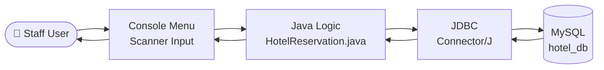
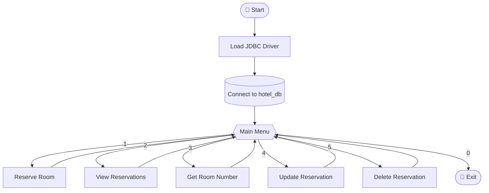

<div align="center">


<br/>


<br/>


<br/><br/>

[About](#-about) •
[Features](#-features) •
[Demo](#-live-demo) •
[Architecture](#-architecture) •
[Setup](#-getting-started) •
[Roadmap](#-roadmap)

</div>

---

## 📖 About

**Hotel Reservation Management System** is a console-based Java application that talks to a **MySQL** database through **JDBC**. Hotel staff can create, view, search, update and delete room reservations from a simple interactive menu.

It's a practical example of **CRUD operations**, **JDBC connectivity** and **database-driven Java development**.

---

## 🚀 Features

| | Feature | What it does |
|:-:|---|---|
| 🛏️ | **Reserve a Room** | Book a room with guest name, room number and contact number |
| 📋 | **View Reservations** | List every reservation with its timestamp |
| 🔍 | **Get Room Number** | Find a room using reservation ID + guest name |
| ✏️ | **Update Reservation** | Edit guest name, room number or contact number |
| 🗑️ | **Delete Reservation** | Cancel a reservation by ID |
| 👋 | **Graceful Exit** | Animated shutdown message |

---

## 🎬 Live Demo

<div align="center">
  
</div>

---

## 🏗️ Architecture



### Menu flow



---

## 🗄️ Database Schema

```sql
CREATE DATABASE hotel_db;
USE hotel_db;

CREATE TABLE reservations (
    reservation_id   INT AUTO_INCREMENT PRIMARY KEY,
    guest_name       VARCHAR(255) NOT NULL,
    room_number      INT          NOT NULL,
    contact_number   VARCHAR(20)  NOT NULL,
    reservation_date TIMESTAMP    DEFAULT CURRENT_TIMESTAMP
);
```

| Column | Type | Notes |
|---|---|---|
| `reservation_id` | `INT` | Primary key, auto-increment |
| `guest_name` | `VARCHAR(255)` | Name of the guest |
| `room_number` | `INT` | Reserved room |
| `contact_number` | `VARCHAR(20)` | Guest phone number |
| `reservation_date` | `TIMESTAMP` | Set automatically |

---

## ⚙️ Getting Started

### Prerequisites

- ☕ JDK 17 or newer
- 🐬 MySQL Server 8+
- 📦 [MySQL Connector/J](https://dev.mysql.com/downloads/connector/j/) (download the platform-independent `.jar`)

### Installation

```bash
git clone https://github.com/rudrarajsingh887/Hotel_Reservation_System.git
cd Hotel_Reservation_System
```

### Configure the connection

Edit these lines in `HotelReservation.java`:

```java
private static final String url      = "jdbc:mysql://localhost:3306/hotel_db";
private static final String username = "root";
private static final String password = "YOUR_PASSWORD";
```

### Run

<details>
<summary><b>▶ Using an IDE (IntelliJ / Eclipse)</b></summary>

1. Open the project folder.
2. Add the downloaded Connector/J `.jar` to the project libraries.
3. Run `HotelReservation`.

</details>

<details>
<summary><b>▶ Using the terminal</b></summary>

```bash
# Compile
javac HotelReservation.java

# Run on Linux / macOS
java -cp ".:mysql-connector-j-8.x.x.jar" HotelReservation

# Run on Windows
java -cp ".;mysql-connector-j-8.x.x.jar" HotelReservation
```

</details>

---

## 📁 Project Structure

```text
Hotel_Reservation_System/
├── 📄 HotelReservation.java   # Menu + CRUD logic
├── 📄 README.md
└── 🎨 assets/                 # Animated README graphics
    ├── header.svg
    ├── terminal.svg
    └── footer.svg
```

---

## 🛣️ Roadmap

- [ ] Use `PreparedStatement` to prevent SQL injection
- [ ] Load DB credentials from environment variables
- [ ] Prevent double-booking of the same room
- [ ] Add check-in / check-out dates
- [ ] Better input validation
- [ ] GUI with JavaFX or Swing
- [ ] Unit tests with JUnit

---

## 🤝 Contributing

1. 🍴 Fork the repo
2. 🌿 Create a branch: `git checkout -b feature/AmazingFeature`
3. 💾 Commit: `git commit -m "Add AmazingFeature"`
4. 📤 Push: `git push origin feature/AmazingFeature`
5. 🔃 Open a Pull Request

---

## 📜 License

Distributed under the **MIT License**.

---

<div align="center">

⭐ **If you like this project, give it a star!** ⭐

<br/>

Made by [@rudrarajsingh887](https://github.com/rudrarajsingh887)

<br/>


</div>
